# Getting Over It, played by reinforcement learning

  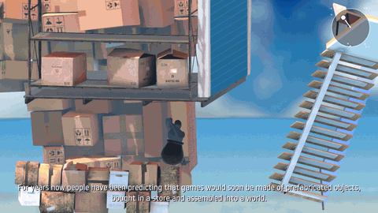

Neural networks playing the real *Getting Over It with Bennett Foddy*, with one goal: be the first to finish it with
reinforcement learning, in one continuous climb from the bottom to the top with no save/load.

**Best run so far: 63% of the way to the top**, in one continuous game from the bottom.

## Progress by part

The climb split into the parts speedrunners use. The networks play each part alone from its entrance, 20 times, with
up to 10 minutes per try; the progress is how many tries got through to the next part (**Solved** from 90%). The
circle in the top corner is the networks' mouse input.

| Part | Progress | |
|---|---|---|
| **Coffee Rock** | Solved | 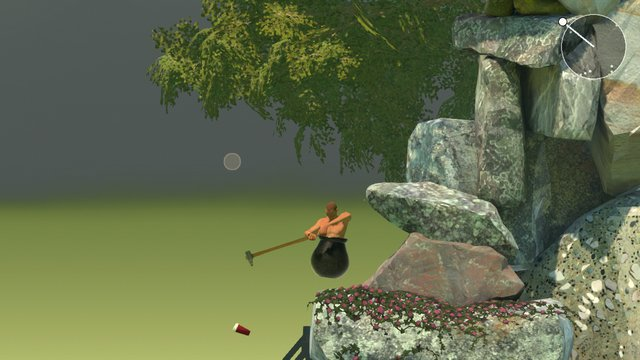 |
| **The Devil's Chimney** | 85% | 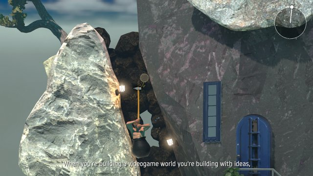 |
| **Construction Wall** | 65% | 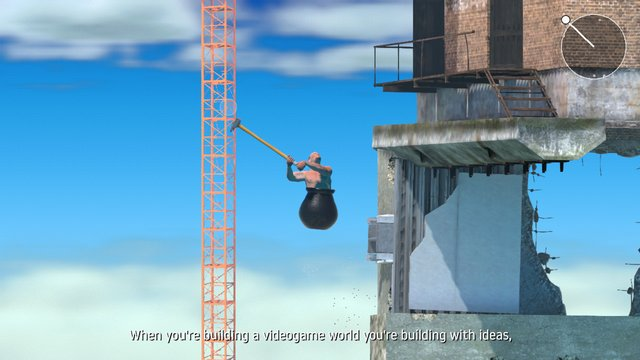 |
| **Slide Skip** | 80% | 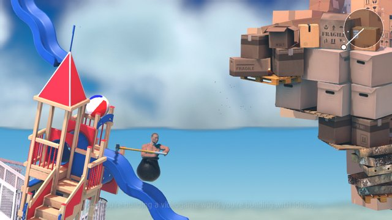 |
| **Furniture Land** | 65% | 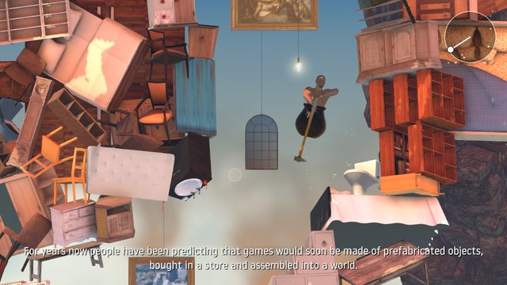 |
| **Orange Hell** | 0% | 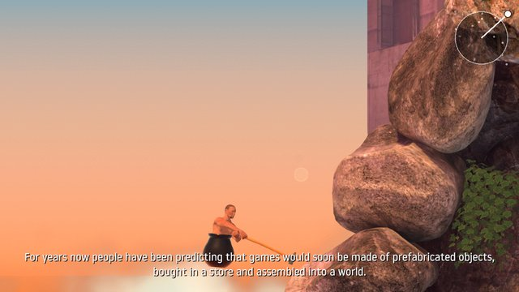 |
| **Bell Tower** | 25% | 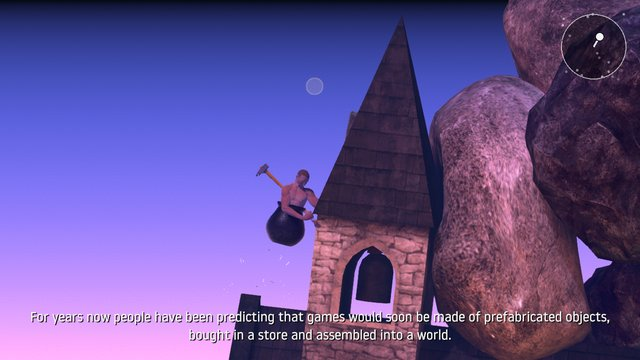 |
| **The Hat** | 25% | 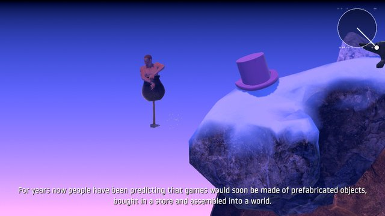 |
| **The Anvil** | 0% | 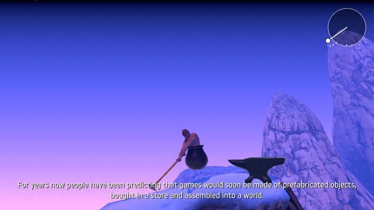 |
| **Floating Platforms** | 0% | 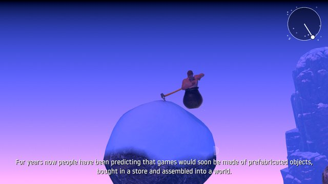 |
| **The Bucket** | 0% | 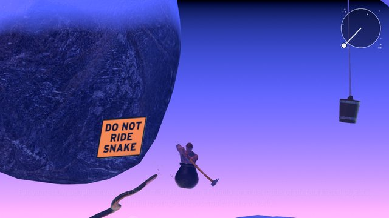 |
| **Mountain Climb** | 0% | 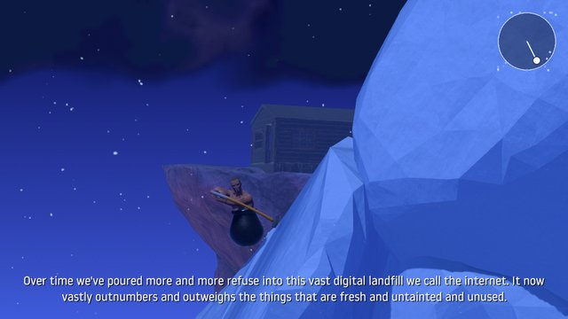 |
| **Satellite Climb** | 0% | 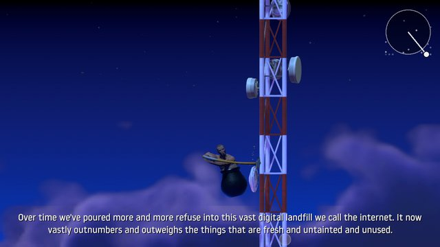 |
| **Space** | 45% | 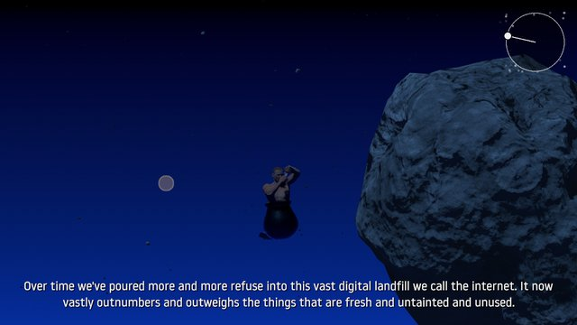 |

## How it works

- A C# plugin (BepInEx) runs inside the game and connects it to Python: physics advances in lockstep with the agent,
  and the whole game can be saved and restored exactly.
- PPO networks (Stable-Baselines3) train on 10 copies of the game at once, about 6,000 steps per second on one PC.
- A search with save/load found climbs through every part. Their states start the training of 27 networks, each
  specialized in one stretch of the route and chained along it.
- Continuous games from the bottom show where the networks get stuck, and those spots get targeted training.

## Models

The networks and a video are on [Hugging Face](https://huggingface.co/miiwater/goi-rl).
