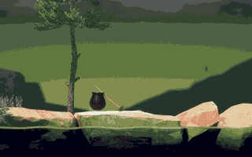

# Getting Over It, played by reinforcement learning

<p align="center">
  
</p>

Neural networks playing the real *Getting Over It with Bennett Foddy*, with one goal: be the first to finish it with
reinforcement learning, in one continuous climb from the bottom to the top with no save/load.

**Best run so far: 63% of the way to the top**, in one continuous game from the bottom.

**Update: a single network trained only in a JAX re-implementation of the game has finished it**, in one continuous
climb from the bottom of the real game. See [The game in JAX](#the-game-in-jax).

## Progress by part

The climb split into the parts speedrunners use. The networks play each part alone from its entrance, 20 times, with
up to 10 minutes per try; the progress is how many tries got through to the next part (**Solved** from 90%). The
circle in the top corner is the networks' mouse input.

| Part | Progress | |
|---|---|---|
| **Coffee Rock** | Solved |  |
| **The Devil's Chimney** | 85% |  |
| **Construction Wall** | 65% |  |
| **Slide Skip** | 80% |  |
| **Furniture Land** | 65% |  |
| **Orange Hell** | 0% |  |
| **Bell Tower** | 25% |  |
| **The Hat** | 25% |  |
| **The Anvil** | 0% |  |
| **Floating Platforms** | 0% |  |
| **The Bucket** | 0% |  |
| **Mountain Climb** | 0% |  |
| **Satellite Climb** | 0% |  |
| **Space** | 45% |  |

## How it works

- A C# plugin (BepInEx) runs inside the game and connects it to Python: physics advances in lockstep with the agent,
  and the whole game can be saved and restored exactly.
- PPO networks (Stable-Baselines3) train on 10 copies of the game at once, about 6,000 steps per second on one PC.
- A search with save/load found climbs through every part. Their states start the training of 27 networks, each
  specialized in one stretch of the route and chained along it.
- Continuous games from the bottom show where the networks get stuck, and those spots get targeted training.

## The game in JAX

<p align="center">
  
</p>

The game's physics (Unity 2020.3 Physics2D, which is Box2D 2.3.1 with Unity's own revolute joint) and the rules on top
of it (the player controller, friction switching, the space section's zero gravity, gravity wells, teleporters and
win) are re-implemented in JAX (`goi_jax/`). A simulated step matches the game's own Box2D world bit for bit, checked
against recordings of the real game made through the plugin. The simulator runs many games in parallel on one GPU:
about 45,000 to 50,000 steps per second at 16,384 to 32,768 games on an RTX 3090, against about 6,000 for 10 copies
of the game. Training happens entirely in the simulator, and the trained network plays the real game unchanged,
because the plugin's observation is bit-identical to the simulator's.

**Result:** one network, trained only in the simulator, won the real game from the bottom in 5 of 11 continuous
climbs (no save/load, no other networks). Of the other six, four were still climbing in space at 810-860 m when the
test's 100-second limit ended them (the win is at 864 m), and two fell and stalled.

How it was trained:
- PPO, written PureJaxRL-style so rollouts, updates, episode bookkeeping and the start curriculum all run on the GPU.
  Episodes start from saved states along the whole route, drawn more often from the sections the network fails to
  cross, plus states found by a Go-Explore search in the simulator.
- When the network stalled at a wall (the Devil's Chimney at 176 m, then the garden's furniture tower at 289 m), a
  copy of it trained only from starts just below that wall, with more exploration noise. Each wall fell in about an
  hour of GPU time. The winning network is the last of these copies; it kept everything the earlier ones learned.

Run it (WSL or Linux with an NVIDIA GPU; the game itself runs on Windows with the plugin installed):

```
uv venv .venv-cuda && uv pip install --python .venv-cuda "jax[cuda13]==0.12.0" -e ".[jax]"
scripts/cuda_run.sh python -u scripts/train_jax.py --name route --start-group all --start-sampling weak --max-minutes 30
.venv/bin/python -m goi_jax.play runs/route/checkpoints/latest.pkl --backend real --steps 6000 --video climb.mp4
```

The winning network, its checkpoint and two full videos are on
[Hugging Face](https://huggingface.co/zimmerk4/getting-over-it-rl-jax).

`scripts/train_jax.py --help` lists the options (start groups, section specialists with `--bank-skip`, warm starts
with `--resume`). `goi_jax.play --ending 90 --watch --video ...` also records the game's own ending after a win.

## Models

The networks and a video are on [Hugging Face](https://huggingface.co/miiwater/goi-rl).

## License

MIT. See [LICENSE](LICENSE).
